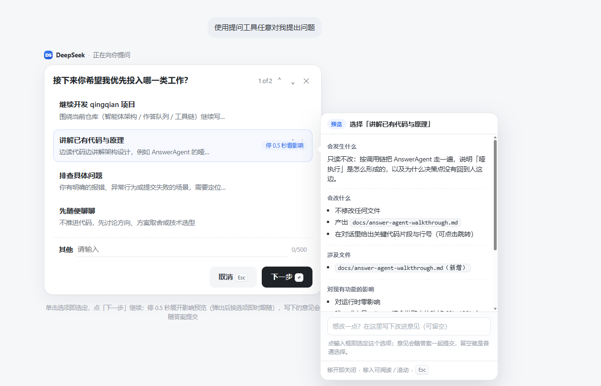
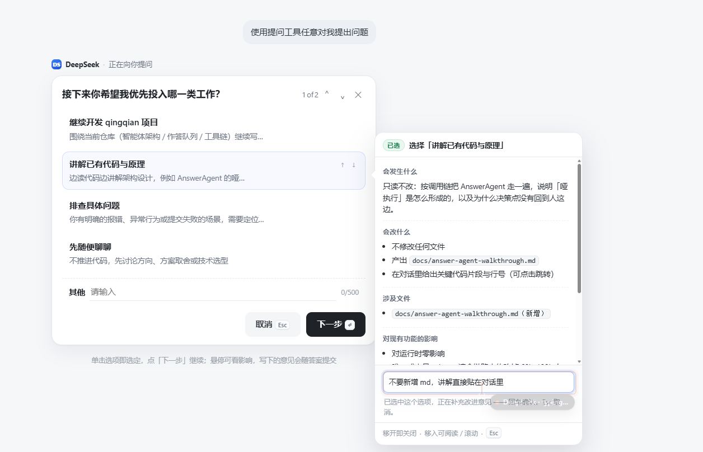
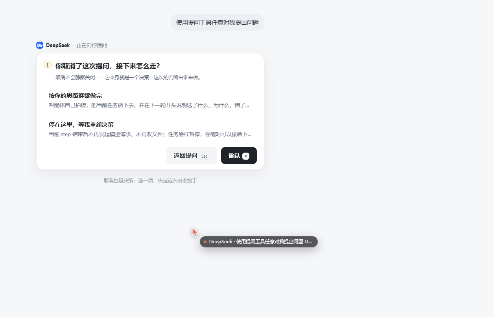
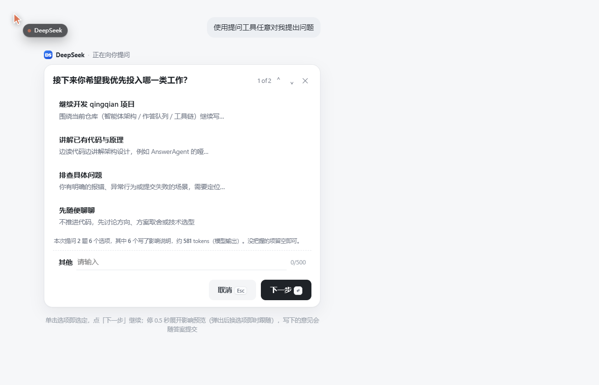

# dsh-ask-panel

在过程中向用户提问，并且让「选它之后会发生什么」看得见：悬停选项拉出影响预览，可以在预览里写改进意见，也可以把决定权交回智能体——取消不等于静默关闭，它本身就是一个决策。



> 上面几张是设计稿渲染的界面预览，结构与交互跟实际插件一致。

安装：

```sh
dsh plugin --profile desktop add github:mouse985/dsh-ask-panel
```

装好后重启一次（客户端那一半在进程启动时注册进页面模块表）。

- 插件市场的条目：`publish/mouse985__dsh-ask-panel.yml`
- 发布流程备忘：`publish/PUBLISH.md`

## 它解决什么

harness 默认一路静默执行。遇到两条实现路线都能讲通、但选错就要返工的岔口时，模型只有两个坏选择：随便挑一个赌，或者停下来等用户说下一句。这个插件提供第三条：把岔口摆出来，且**每个选项都带着代价**——改哪些文件、影响哪些现有行为、风险高低、大概几轮。用户在悬停的一刻就补齐了判断所需的信息。

## 用户看到什么

1. 卡片出现在输入框的位置（composer 接管），标题 + `1 / 2` 翻页 + `×`。
2. 选项单击即选定；停在选项上 0.5 秒展开右侧预览（弹幕已在场时换选项即时跟随）。
3. 单选与多选是两种交互：默认单选（圆点，再点一次取消，选别的自动换）；题目标了「可多选」时标题旁出现 `可多选` 标签、标记变方框，点几个选几个，再点一次取消其中一个。选了多个时标题旁还会显示 `已选 n 项`。
4. 每题自动带一行 `〔其他〕`：勾上它，行内展开输入框，写你自己的答案。这一项是必须的，不写就提交会提示补上。
5. 预览里五段：会发生什么、会改什么、涉及文件、对现有功能的影响、风险与成本。鼠标移进去可以慢慢读、可以滚动，移开 220ms 后收起。
6. 预览底部是意见输入框：写了就随答案一起提交，留空就是普通选择。
7. 点「取消」不是关掉——弹出接管卡，两个选择：*按你的思路继续做完* / *停在这里，等我重新决策*。
8. 下一条自动附带 `〔按你的判断继续〕` 选项，模型随时可以把决定权交回来。





## 它真的影响智能体

| 用户动作 | 线上发生什么 | 智能体侧 |
|---|---|---|
| 选一个选项 | `question/requested` 的答案回传 | 工具返回 `{kind:'answered', answers:[{label}]}`，step 继续 |
| 选项 + 意见 | 同上，`custom` 里编码 `label` 与 `note` | 返回 `{label, note}`，模型按意见执行 |
| 自由输入 | 「其他」写的内容以 `custom` 原样回传 | 返回 `{custom}` |
| 选「按你的判断继续」 | 每题回传 `〔按你的判断继续〕` | 返回 `{kind:'deferred', choice:'proceed'}`，模型自行决定并说明 |
| 取消 → 停下来 | `respond({ok:false, error:{code:'cancelled'}})` | host 以 `ASK_CANCELLED` 拒绝 → 工具调用 `exec.concludeTurn()` → **本轮 step 以 completed 结束，不再发起 model request** |
| 取消 → 按你的思路 | 回传「按你的判断继续」 | 同 proceed |

`concludeTurn` 是 DSH 公开的工具契约（`ToolRunContext.concludeTurn()`，`packages/core/tools/src/index.ts:420`），不是 hack：它让工具结果携带 `concludesTurn: true`，agent loop 在 `packages/core/agent-loop/src/tool-calls.ts:157` 收敛为「本轮结束」。所以「停下来等你」是真的停住，而不是嘴上停。

## 成本控制

- 一次调用 ≤ 3 题、每题 ≤ 6 个选项；合并提问，禁止连续多次 ask。
- 请求体 ≤ 2 KB（编码后超过就返回 `refused` 并说明怎么精简，不静默截断）。
- 每会话 ≤ 3 次调用；第 4 次返回 `refused`，提示「自己定，标注待确认」。
- 影响说明按需写：只写 `summary` 也能渲染，未填段落折叠；全空显示「（这项没有填写影响说明）」。
- 结果只回结论：工具返回的是 `{questionId, label, note}` 这个量级，不回显问题全文与影响说明。
- 悬停、预览、写意见都不发请求。



## 契约（实现依据）

- host 半注册工具 `ask_user`，走既有 `ctx.userQuestions.ask()`；**不注册 provider**（web 通道只有一个 provider，重复注册会 `DUPLICATE_PROVIDER`）。
- 影响数据编码进 `options[].description`：`summary` + `\n[[impact]]` + JSON。出厂卡片会把它当普通描述显示，本插件解析后渲染成结构化预览。
- 意见回传编码：单选时 `matchesQuestions` 不允许 `custom` 与 `selected` 同时存在（`packages/host/apiproxy/src/api-proxy.ts:726-729`），所以「选项 + 意见」发 `{selected: [], custom: label + '\n[[note]]' + note}`，由 host 半解码。
- 合成选项：host 半在模型给的选项之后插 `〔其他〕`（`description` 为 `[[other]]`）、再插 `〔按你的判断继续〕`；「其他」写下的文本走 `custom`，多选时其余 `selected` 保留，单选清空 `selected`（同一条限制）。
- client 半注册 `conversation.composer` 链条目，`priority: -2`（出厂 question 卡是默认 0，数值小的先试），`select` 只认带 `〔按你的判断继续〕` 的批次，其余请求留给出厂卡片。

## 自测

```sh
node tests/harness.mjs
# @@RESULT@@{"ok":true,"host":{"tool":"ask_user","cases":12},"client":{"entries":1,"answers":4}}
```

harness 用桩件驱动真实的 host 模块与 client 模块：编码/解码往返、halt 触发 `concludeTurn`、proceed 路径、超体积与超次数拒绝、选择器只认自家批次、答案构造、单选/多选拾取归约、「其他」自由输入与提交校验、成本估算、链条目注册。

## 状态

- [x] host 工具 `ask_user`（影响数据编码、预算、halt 语义）
- [x] client 卡片（选项 + 0.5s 悬停预览 + 意见输入 + 取消接管卡）
- [x] 载入 profile 并在真实会话里注册成功
- [x] 单选（圆点：再点取消、换选项自动替换）
- [x] 多选（`multi_select: true` → 标题旁 `可多选` 标签、方框标记、可累加与逐个取消）
- [x] `〔其他〕` 自由输入行（每题强制附带，勾上后就地输入，空着提交会拦下）
- [x] 已选项计数（多选且 `n > 0` 时标题旁显示 `已选 n 项`）
- [ ] 决策说明的落库事件（`ask.answered` / `ask.decision.delegated` / `ask.decision.halted`，见 `dsh-ask-probe/docs/agent-decision.md`）
- [ ] 提问次数与体积的度量面板
